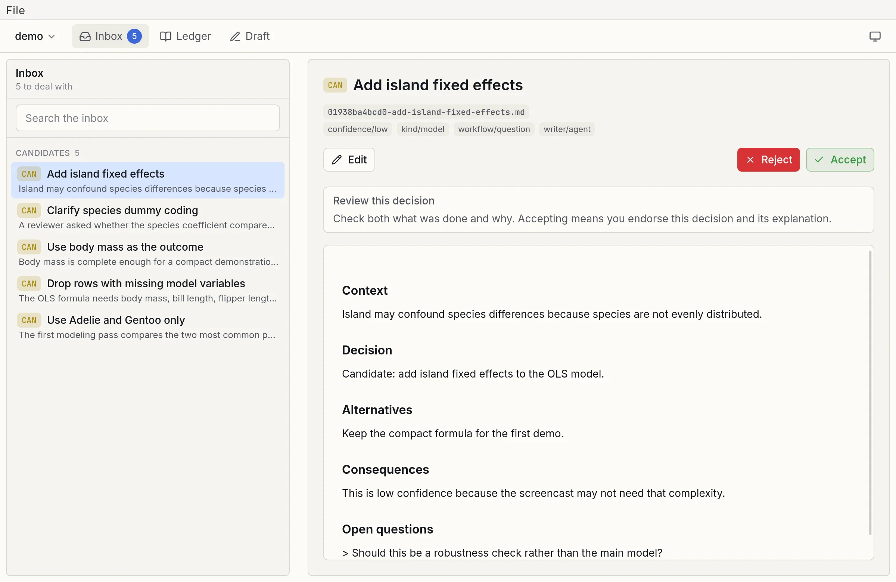

# Standalone app

You can also use DADRock through a cross-platform standalone app built with [Tauri](https://tauri.app). It opens a project folder in its own window and shows the same interface as the [web interface](web.md). Download it for macOS, Windows, or Linux from the [latest release](https://github.com/vincentarelbundock/dadr/releases/latest).

<figure class="screenshot" markdown>
{ loading=lazy }
</figure>
