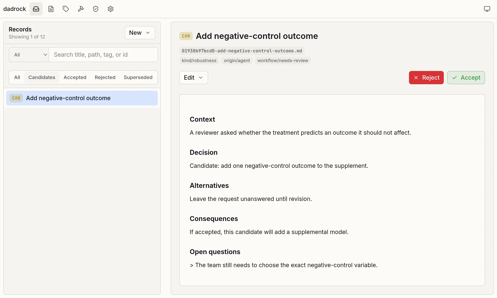

# Web interface

After [installing DADRock](index.md), start the web interface from your analysis project with:

```sh
dadrock preview
```

Then open the address it prints, normally <http://127.0.0.1:4004>, in your browser. `dadrock preview DIRECTORY` serves another project, and `--port` picks another port.

<figure class="screenshot" markdown>
{ loading=lazy }
</figure>
