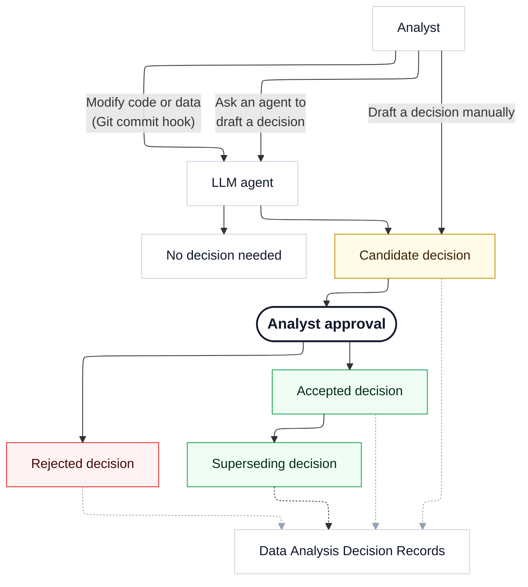

<div class="hero" markdown>

<br>
<p class="hero-tagline">A lightweight file specification, workflow, and set of tools to capture the <b>human decisions</b> that drive our results.
</div>

<div class="problem" markdown>

## Problem 1: Opacity

<div class="problem-body" markdown>

<div class="problem-prose" markdown>
Every data analysis rests on dozens of choices: which observations to include, how to code key variables, which model to fit, how to quantify uncertainty, which robustness checks to report, etc. These decisions can have major consequences. Indeed, *Many Analysts* studies show that when independent teams analyze the same data and the same hypotheses, they routinely arrive at very different results.[^many-analysts]

[^many-analysts]:
    Silberzahn et al. (2018), "Many Analysts, One Data Set: Making Transparent How Variations in Analytic Choices Affect Results," *Advances in Methods and Practices in Psychological Science* 1(3): 337–356, [doi:10.1177/2515245917747646](https://doi.org/10.1177/2515245917747646).
    Botvinik-Nezer et al. (2020), "Variability in the Analysis of a Single Neuroimaging Dataset by Many Teams," *Nature* 582: 84–88, [doi:10.1038/s41586-020-2314-9](https://doi.org/10.1038/s41586-020-2314-9).
    Huntington-Klein et al. (2021), "The Influence of Hidden Researcher Decisions in Applied Microeconomics," *Economic Inquiry* 59(3): 944–960, [doi:10.1111/ecin.12992](https://doi.org/10.1111/ecin.12992).
    Breznau et al. (2022), "Observing Many Researchers Using the Same Data and Hypothesis Reveals a Hidden Universe of Uncertainty," *PNAS* 119(44): e2203150119, [doi:10.1073/pnas.2203150119](https://doi.org/10.1073/pnas.2203150119).

Unfortunately, many of the choices that drive data analytic results are not surfaced in the methods sections of reports and articles. And even when an analyst makes available their full code and data, reconstructing their decisions and rationales retrospectively can often feel like an impossible archeology project.
</div>

<div class="pull pull--aside" markdown>
A simple way to record what was decided, why, what alternatives were considered, and what the consequences are.
</div>

</div>

</div>

<div class="problem" markdown>

## Problem 2: Drift

<div class="problem-body" markdown>

<div class="problem-prose" markdown>
Analysts who work on complex projects can sometimes lose track of key decisions and the reasons behind them. Over time, their codebase can slowly drift away from the original intent of the project, and minor-looking coding decisions can completely change the interpretation of empirical results. This risk is especially pronounced when part of the analysis is delegated to agentic coding, which produces a lot of hard-to-review code.
</div>

<div class="pull pull--aside" markdown>
A human-approved, auditable, and authoritative record of the key decisions made in a project.
</div>

</div>

</div>


## Solution: Data Analysis Decision Records

Data Analysis Decision Records (DADR) are designed to make our key analytical choices explicit. Each decision becomes a short Markdown record, stored alongside the code, data, and prose of a project. The DADR markdown files are human-editable, LLM-readable, and version-controllable. They include meta-data fields and tags that enable external tools to track decision flows, audit the faithfulness of a codebase to recorded decisions, and generate reports and narratives directly from the decision ledger.

DADR is not meant to be a comprehensive record of every thought, but rather a focused ledger of the key decisions that shape an analysis. It is a simple specification inspired by the [Architecture Decision Record](https://learn.microsoft.com/en-us/azure/well-architected/architect-role/architecture-decision-record), a proven and popular development practice in the software engineering community.

## Audience

DADR serves three audiences:

<div class="audience-grid" markdown>

<div class="audience" markdown>
<div class="audience-icon">👤</div>
**Researcher**

A transparent reminder of past decisions and the reasons behind them.
</div>

<div class="audience" markdown>
<div class="audience-icon">👥</div>
**Readers**

People who want to understand which decisions were made and why, without having to reconstruct the analyst's intent from code or git commit history.
</div>

<div class="audience" markdown>
<div class="audience-icon">🤖</div>
**LLMs**

Machines can verify if the analyst's intent is implemented faithfully in the code, a pre-analysis plan, or a report.
</div>

</div>

## Frictionless

DADR is easy to implement because automated tools and LLMs do all the hard work! In the vast majority of cases, all the analyst needs to do is click "Accept" or "Reject" to determine if a candidate decision should enter the permanent record.

A decision can be initiated in several ways:

1. The LLM agent walks a code base to detect important decisions and drafts candidate decisions for them.[^static-analysis]
2. The LLM agent detects a change in the code, analyzes the change, and drafts a candidate decision if necessary (Git hook).
2. The LLM agent drafts a candidate decision based on analyst-supplied prompt and context.
3. The analyst drafts a candidate decision manually.

[^static-analysis]: The agent can have access to static analysis or instrumentation tools to better infer the consequences of a code chunk. Supplying these tools is on the roadmap for the **dadrock** tool.

<div class="principle" markdown>
Every candidate decision <b>must</b> be approved by the human analyst before it enters the permanent record.
</div>

## New possibilities

A complete, structured trace of analytic decisions is more than documentation. It is an asset that downstream tools and humans can act on.

<div class="feature-grid" markdown>

<div class="feature" markdown>
#### Faithfulness
Compare code, plan, and manuscript against recorded decisions to flag drift, undocumented choices, or contradictions. An LLM walks the relevant code paths and produces a discrepancy report for human triage.
</div>

<div class="feature" markdown>
#### Compliance
Cross-check decisions against a Statistical Analysis Plan (SAP), a Pre-Analysis Plan (PAP), Pre-registration, or data cleaning plan to surface deviations and unexecuted commitments.
</div>

<div class="feature" markdown>
#### Multiverse and robustness
Automatically surface the choices that need to be subjected to sensitivity, robustness, or multiverse analysis.
</div>

<div class="feature" markdown>
#### Decision flow
Follow how analytic choices evolved: which decisions replaced which, when, and why.
</div>

<div class="feature" markdown>
#### Drafting
Generate methods sections, appendices, and decision tables directly from the trace, with citations back to the records.
</div>

<div class="feature" markdown>
#### Onboarding
Hand a collaborator or new contributor a readable narrative instead of a code-archaeology assignment.
</div>

<div class="feature" markdown>
#### Replication and reuse
Give independent analysts a self-contained rationale for every consequential choice.
</div>

<div class="feature" markdown>
#### Coverage and audit
Report which analysis activities are backed by decisions, which are unreviewed, and which have gone stale.
</div>

<div class="feature" markdown>
#### Teaching
Use real annotated analyses to show how defensible alternatives were considered and chosen.
</div>

</div>

## Workflow 

Candidate decisions can be drafted automatically by a LLM agent, or manually by the analyst. Every candidate decision *must* be reviewed by the human analyst before it enters the permanent record. The analyst can either accept the candidate decision, reject it, or draft a superseding decision that replaces it. Every decision (candidate, accepted, rejected, superseded) is recorded in the DADR ledger to create a complete trace of how the analysis evolved over time.

<div class="diagram" markdown>



</div>

## Example

```yaml
---
title: Drop observations with missing treatment assignment
status: accepted
id: 01938c20-a3b4-7000-8000-111122223333
tags:
  - kind/sample
  - confidence/high
---

## Context

The randomization log is missing the treatment field for 47 of 8,213
respondents. Without an assignment we cannot estimate either
intent-to-treat or per-protocol effects for those rows. This extends
the sampling rule established in [[01938b8e4d70]].

## Decision

> #axis/sample/complete-case
> Drop the 47 respondents without recorded treatment assignment from
> the analysis sample.

## Alternatives

- Multiple imputation of the assignment indicator (rejected: assignment
  is a treatment, not a covariate; imputing it would invent
  counterfactual exposures).
- Coding the missing rows as control (rejected: silently biases the ITT
  estimate toward the null).

## Consequences

The analysis sample drops from 8,213 to 8,166. Power calculations need
to be re-run; see [[01938c30b1e2]].
```

<div class="hero-buttons" style="margin-top: 2.5rem">
  <a class="md-button" href="getting-started/">Get started</a>
  <a class="md-button" href="specification/">Read the specification</a>
</div>
